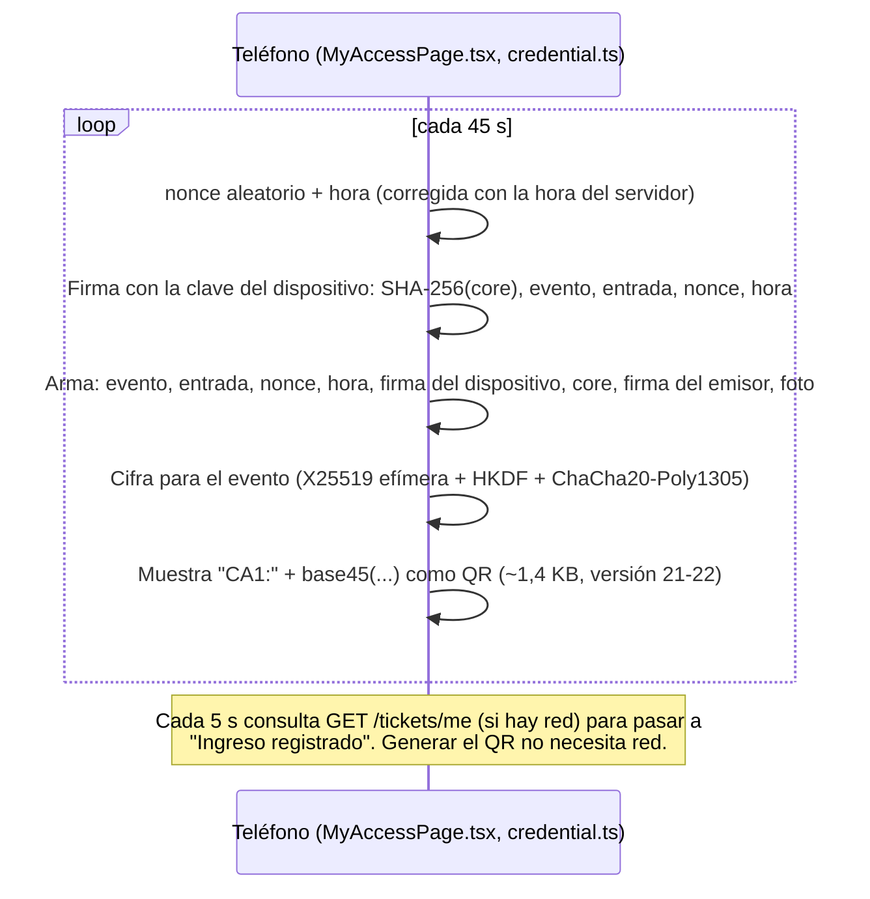
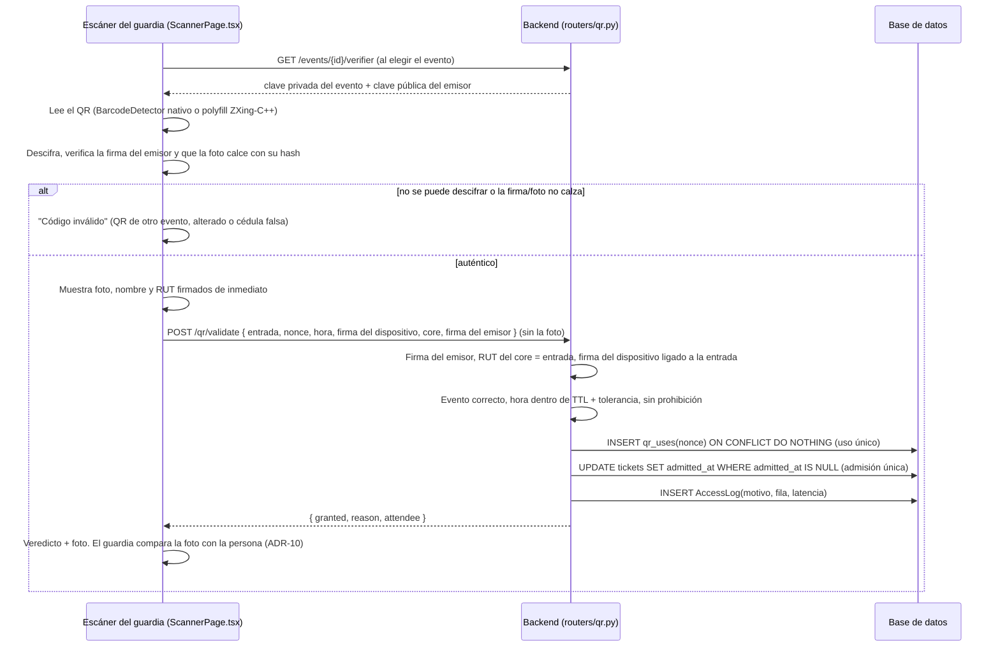

# Arquitectura del prototipo de verificación por QR dinámico

Los diagramas siguientes reflejan el flujo **real** implementado (no un diseño aspiracional):
cada paso referencia el archivo y la función que lo ejecuta.

## 1. Cédula digital y activación de la entrada

La cédula (nombre, RUT, foto) la emite el Registro Civil; aquí, un emisor **simulado** separado del
sistema del evento (`backend/scripts/registro_civil_sim.py`). El backend del evento solo conoce su
clave pública y **nunca recibe la foto** (ADR-11).

```mermaid
sequenceDiagram
    participant RC as Registro Civil (simulado)
    participant T as Teléfono (ClaimTicketPage.tsx, wallet.ts)
    participant B as Backend del evento (routers/tickets.py)

    RC->>T: Archivo de la cédula: core + firma Ed25519 del emisor + foto
    Note over RC,T: core = versión, fecha, RUT, nombre, SHA-256(foto)
    T->>T: Importa el archivo localmente (la foto no sale del teléfono)
    T->>T: Crea la clave del dispositivo (Ed25519)
    T->>B: POST /tickets/claim { RUT, código de entrada, clave pública del dispositivo, core, firma del emisor }
    B->>B: RUT + código válidos (401 uniforme, rate limit; ADR-7)
    B->>B: Verifica la firma del emisor sobre el core y que el RUT del core sea el de la entrada
    B->>B: Guarda la clave pública del dispositivo (Ticket.device_public_key)
    B-->>T: sesión + { evento, entrada, clave pública X25519 del evento, TTL, hora del servidor }
```

## 2. Generación del QR (en el teléfono, sin conexión)



## 3. Verificación en la puerta



## 4. Manejo de errores del escáner

```mermaid
sequenceDiagram
    participant G as Escáner (ScannerPage.tsx)
    participant Cam as Cámara (html5-qrcode)
    participant B as Backend

    G->>Cam: Html5Qrcode.start()
    alt cámara no disponible o permiso denegado
        Cam-->>G: NotFoundError / NotAllowedError
        G->>G: Banner de error + opción "Leer QR desde una imagen"
    else escaneo exitoso
        Cam-->>G: decodedText
        G->>G: Verificación local (sección 3)
        G->>B: POST /qr/validate
        alt sin conexión
            G->>G: "Sin conexión": muestra foto e identidad verificadas localmente y la<br/>vigencia; avisa que no se pudo comprobar uso único ni prohibiciones
        end
    end
```

## 5. Decisiones de diseño (ADR)

**ADR-1 (REEMPLAZADO por ADR-11) — Token opaco verificado contra estado del servidor, en vez de un
token autocontenido y firmado.**
*Se conserva el registro de la decisión original.*
Se optó por un identificador aleatorio (UUID v4) que el backend busca en su base de datos, en
lugar de un token tipo JWT que incluyera su propia firma y expiración verificables sin consultar
la base de datos. *Razón*: un token opaco es trivialmente revocable en cualquier momento (borrar o
marcar la fila) y no requiere gestión de claves de firma adicional para este componente; el costo
es que no hay verificación offline ni autoverificación criptográfica (declarado explícitamente en
`security-guarantees.md §2.1`). Alternativa considerada y descartada para este prototipo: firmar
el payload con HMAC para que el verificador pudiera comprobar la expiración sin ir a la base de
datos primero — se descarta porque no cambia la propiedad de fondo (revocación temprana seguiría
requiriendo consulta al servidor) y añade superficie de implementación sin mover la clasificación
de garantía de la Sección 5 de `security-guarantees.md`.

**ADR-2 (REEMPLAZADO por ADR-11) — Generar un QR nuevo invalida cualquier QR anterior sin usar del
mismo usuario.**
Reducía la ventana real de exposición por debajo del TTL nominal y evitaba varios códigos "vivos" a
la vez. Con ADR-11 el QR lo genera el teléfono sin conexión, así que el servidor no sabe qué QR
existen y no puede revocar el anterior. Lo que acota el efecto ahora es la admisión única por
entrada (ADR-8): aunque haya varios QR vigentes de la misma entrada, solo uno puede servir, y
después de ese ingreso ninguno sirve. La revocación de todos los QR futuros de una entrada sigue
existiendo: liberar el dispositivo (`POST /tickets/{id}/reset`) borra su clave pública.

**ADR-3 — TTL de 45 segundos.**
Justificado en `docs/ttl-justification.md` a partir de dos cotas (usabilidad ajustada por
arquetipos de usuario, y exposición a *replay* anclada en RFC 6238), no elegido por conveniencia.

**ADR-4 — SQLite como almacenamiento.**
Adecuado para un prototipo de alcance acotado (decenas de usuarios concurrentes de prueba); se
declara explícitamente como **no apto para un despliegue de producción a escala** — un
reemplazo por PostgreSQL no cambiaría ninguna de las propiedades de seguridad discutidas, es
puramente una decisión de escala de infraestructura fuera del alcance de este trabajo.

**ADR-5 — Sin verificación biométrica automática.**
Ver justificación completa en `security-guarantees.md §4` (minimización de datos, alcance de
prototipo, consistencia con el modelo de amenazas). *Matiz desde ADR-10:* el guardia ve una foto
firmada y la compara con la persona, como hoy con el carnet. No hay reconocimiento facial, ni
plantillas biométricas, ni almacenamiento de la foto en el sistema del evento.

**ADR-6 — Modelo de roles `admin` / `guard` / `resident`.**
Mapea los tres actores físicos reales de un control de acceso (quien administra el sistema, quien
verifica en portería, quien solicita el ingreso), en vez de un modelo de permisos más granular
tipo RBAC completo — proporcionado por `require_roles` (`backend/app/deps.py`), suficiente para el
alcance del prototipo y consistente con los hallazgos de la encuesta, que identifican tres tipos de
interacción con un sistema de identificación digital (usuario final, verificador institucional,
administrador del sistema).

> **Actualización (caso de aplicación: eventos masivos).** El rol `resident` se eliminó: el usuario
> final ya no tiene cuenta, sino una **entrada nominativa** (`Ticket`) que obtiene su sesión con
> RUT + código de entrada (ADR-7). Los tres actores se mantienen: asistente, guardia de fila,
> administrador del evento.

**ADR-7 — El asistente obtiene su QR con RUT + código de entrada, no con un solo dato personal.**
Pedir solo el RUT (o email) sería *identificación* sin *autenticación*: el RUT es conocido por
terceros, así que cualquiera podría generar el QR de otra persona y entrar primero (A7 en
`threat-model.md`). El código de entrada (8 caracteres, ~40 bits, entregado al comprar y guardado
solo como hash SHA-256) agrega un factor de posesión sin requerir contraseña ni servicios externos
(correo/SMS). `POST /tickets/claim` responde un 401 idéntico ante cualquier fallo (anti enumeración)
y tiene rate limit por IP. El primer claim liga la entrada a una sesión (`Ticket.claim_session`,
viaja como `sid` en el JWT): un segundo dispositivo recibe 409 hasta que soporte la libere (A8).
Alternativa descartada por ahora: RUT + OTP por correo — más fricción y dependencia de un
proveedor de envío; queda como extensión para recuperar acceso desde otro dispositivo.

**ADR-8 — Admisión única por entrada y consumo atómico del QR.**
El uso único por *token* no basta en un evento: tras ingresar, la persona podría generar otro QR y
pasárselo a alguien (pass-back, A9). `Ticket.admitted_at` se fija al primer ingreso y bloquea
nuevas emisiones. Además, con varias filas escaneando en paralelo, leer `used` y luego escribirlo
dejaba una carrera. Con ADR-11 el uso único es un `INSERT` del nonce del QR en `qr_uses` (clave
primaria) con `ON CONFLICT DO NOTHING`, decidido por `rowcount`; la admisión es un
`UPDATE ... WHERE admitted_at IS NULL` (`routers/qr.py::validate_qr`). Lo cubre un test concurrente
y la prueba de carga (0 dobles concesiones).

**ADR-9 — Filas (`Gate`) y métricas por fila como evidencia empírica.**
El aporte de la tesis es de seguridad (QR no reutilizable frente al QR estático del carnet físico,
`threat-model.md §6`), pero la validación en línea podría alargar las filas. Eso no se puede
descartar sin medirlo. Cada escaneo
registra su fila (`gate_id`) y su latencia de validación en el servidor (`latency_ms`);
`GET /metrics` agrega por fila escaneos, concedidos, rechazos por motivo, escaneos/min y latencia
p50/p95. Con la tasa de llegada, el largo esperado de fila se estima por teoría de colas (ley de
Little). La prueba de carga y el modelo de colas están en `docs/queue-model.md`. Con latencia
realista, el QR dinámico suma ~24 ms por persona (+3 % de espera en la punta) y el servidor opera
al 17 % de su capacidad. La consulta en línea se mantiene con ADR-11 (uso único, admisión y
prohibiciones la deciden el servidor): el riesgo que queda es la conectividad del recinto, no la
capacidad. ADR-11 lo atenúa: sin red, el escáner igual verifica identidad, foto y vigencia.

**ADR-10 (IMPLEMENTADO) — Foto de referencia firmada, dentro del QR.**
En el carnet físico, la verificación visual compara a la persona con una foto impresa en el mismo
objeto que se puede falsificar. Aquí la foto viaja **dentro del QR**, firmada por el Registro Civil
(su hash va en el core firmado), y el escáner la muestra al leerlo. Falsificar o cambiar la foto
rompe la firma. *Primera versión (descartada):* que el backend sirviera la foto al escanear. Se
descartó porque ponía la foto de cada asistente en el servidor del evento y en la red en cada
escaneo; el autor pidió que la foto no se suba a la red y viaje en el QR, como en la cédula digital.
Con la foto en el QR, el sistema del evento nunca la recibe ni la guarda (ver ADR-11).
*Efecto:* cierra el préstamo de credencial con cooperación de un tercero (A10) y el reenvío en tiempo
real a un cómplice (A1), **siempre que el guardia compare bien la foto** (`attack-experiment.md`).
La comparación la hace una persona, con los errores propios de comparar rostros desconocidos; no
es biometría automática (ADR-5).

**ADR-11 — El QR lo genera el teléfono: credencial firmada por el emisor, firma del dispositivo y
cifrado para el evento.**
Reemplaza a ADR-1 y ADR-2. Tres claves con papeles distintos (`backend/app/credential.py`,
`frontend/src/credential.ts`):
- **Emisor (Ed25519, Registro Civil):** firma el core de la cédula (RUT, nombre, hash de la foto).
  Hace que foto, nombre y RUT sean auténticos. El backend verifica la firma **sin la foto**, porque
  el core lleva su hash.
- **Dispositivo (Ed25519, teléfono):** firma cada QR (hash del core, evento, entrada, nonce, hora).
  Liga el QR al teléfono donde se activó la entrada. Copiar el archivo de la cédula a otro teléfono
  no basta (A8).
- **Evento (X25519):** el teléfono cifra el QR con la clave pública del evento (clave efímera +
  HKDF-SHA256 + ChaCha20-Poly1305). Quien fotografíe el QR en la fila no puede leer foto, nombre ni
  RUT; tampoco lo puede leer el escáner de otro evento.

*Por qué firmar y además cifrar:* el cifrado solo no impide falsificar (cualquier escáner tiene la
clave para descifrar y podría fabricar un QR con otra foto). La firma da autenticidad; el cifrado
da confidencialidad frente a terceros en la fila.

*Por qué se mantiene la consulta en línea:* uso único, admisión única (anti pass-back) y
prohibiciones de último minuto requieren estado compartido entre puertas. Sin red, el escáner
verifica localmente identidad, foto y vigencia, y lo avisa como verificación parcial.

*Costos y límites:*
- **Tamaño.** El QR pasa de un UUID a ~1,4 KB (versión 21-22, nivel de corrección L), con la foto
  comprimida a ~650 B (WebP 72×96). Se lee sin problemas desde 3 px por módulo con ZXing. El
  decodificador de respaldo de `html5-qrcode` (zxing-js) **no** lo lee, así que el escáner usa
  `BarcodeDetector` (nativo en Chrome de Android/macOS) o un polyfill con ZXing-C++ en WebAssembly
  servido localmente (`frontend/src/barcodeDetector.ts`).
- **Clave privada del evento en el escáner.** Quien robe un escáner puede leer los QR de ese evento
  (privacidad), pero no fabricarlos: le faltan la clave del dispositivo y la firma del emisor.
- **Clave del dispositivo en `localStorage`.** Limitación del prototipo; en una cédula digital real
  va en el almacén seguro del teléfono (Secure Enclave / StrongBox).
- **Reloj.** El teléfono fecha el QR con la hora del servidor (desfase medido al activar) y el
  servidor acepta una tolerancia de `QR_CLOCK_SKEW_SECONDS` (5 s). Un QR fechado en el futuro se
  rechaza.
- **Emisor simulado.** Una sola clave, sin certificados, sin lista de revocación ni rotación. En un
  despliegue real sería la infraestructura del Registro Civil (p. ej. al estilo ISO/IEC 18013-5).

## 6. Diseño de interfaz orientado a los arquetipos de usuario (Anexo A.2)

Ver `README.md §Mapeo a la tesis` para la tabla completa de trazabilidad entre cada arquetipo, su
recomendación de diseño y el elemento de interfaz correspondiente en `frontend/src/pages/`.
