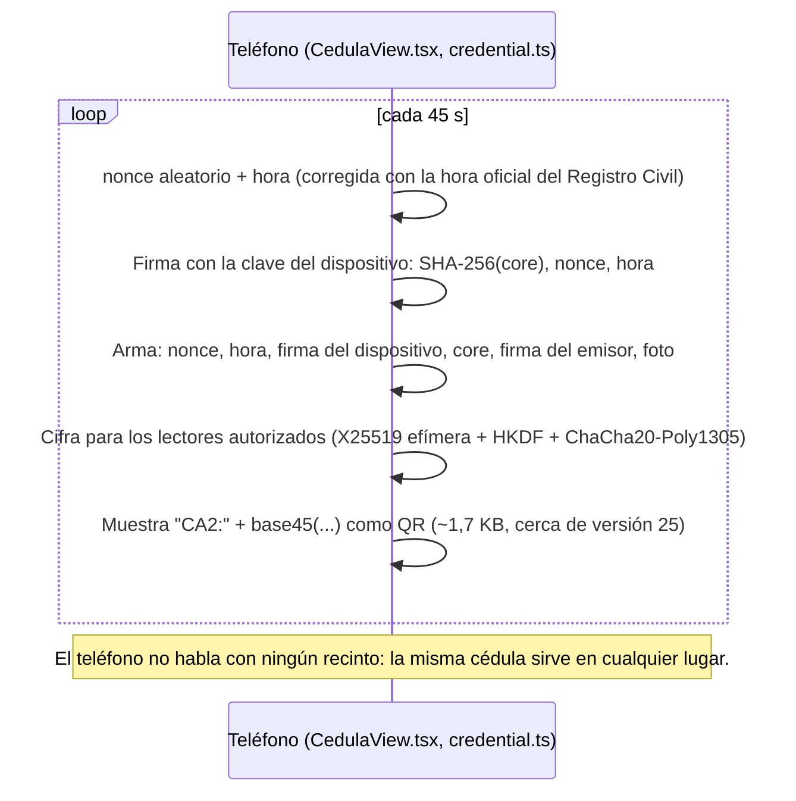
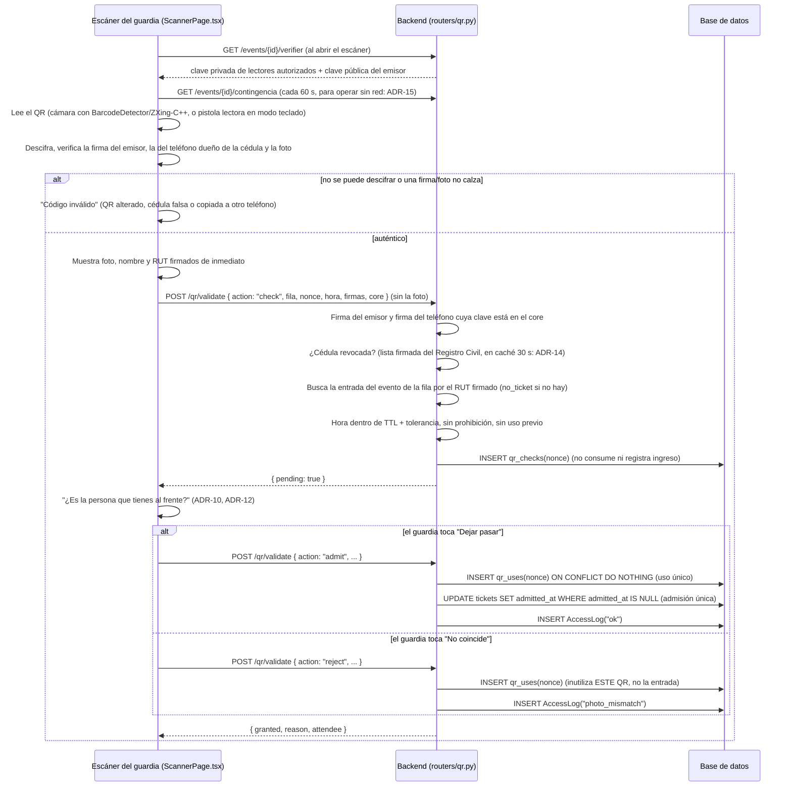

# Arquitectura del prototipo de verificación por QR dinámico

Los diagramas siguientes reflejan el flujo **real** implementado (no un diseño aspiracional):
cada paso referencia el archivo y la función que lo ejecuta.

## 1. Cédula digital (enrolamiento, una vez por teléfono)

La cédula es **de la persona, no de un evento** (ADR-13), como la app de Identificación Digital. La
emite el Registro Civil; aquí, un servicio **simulado** separado del sistema del recinto
(`backend/registro_civil/app.py`). El recinto solo conoce la clave pública del emisor y la clave de
lectores autorizados; **nunca recibe la foto**.

```mermaid
sequenceDiagram
    participant T as Teléfono (CedulaPage.tsx, wallet.ts)
    participant RC as Registro Civil simulado (registro_civil/app.py, :8001)

    T->>T: Crea la clave del dispositivo (Ed25519)
    T->>RC: POST /enrolar { RUT, clave de activación (simula la ClaveÚnica), clave pública del teléfono }
    RC->>RC: Revoca la cédula que la persona tenía en otro teléfono (ADR-14)
    RC-->>T: Cédula: core + firma del emisor + foto, clave pública de lectores, hora oficial
    Note over RC,T: core = versión, fecha, RUT, nombre, SHA-256(foto), clave pública del teléfono
    T->>T: Crea un PIN de 6 dígitos y guarda cédula + clave cifradas con él
    Note over T: Uso diario: el PIN abre la cédula; tras 60 s en segundo plano se vuelve a pedir
    T->>RC: GET /revocaciones (al abrir la cédula)
    RC-->>T: Lista firmada de cédulas revocadas: si está la suya, "Tu cédula ya no es válida en este teléfono"
```

Si se pierde el teléfono, la persona entra a "¿Perdiste tu teléfono? Desactiva tu cédula" desde otro
dispositivo (`POST /reportar-perdida` con RUT + clave de activación) y la cédula del teléfono perdido
queda revocada (ADR-14).

## 2. Generación del QR (en el teléfono, sin conexión)



## 3. Verificación en la puerta



## 4. Manejo de errores del escáner

```mermaid
sequenceDiagram
    participant G as Escáner (ScannerPage.tsx)
    participant Cam as Cámara (html5-qrcode)
    participant B as Backend

    G->>Cam: Html5Qrcode.start()
    alt cámara no disponible o permiso denegado
        Cam-->>G: NotFoundError / NotAllowedError
        G->>G: Banner de error + opción "Leer QR desde una imagen"
    else escaneo exitoso
        Cam-->>G: decodedText
        G->>G: Verificación local (sección 3)
        G->>B: POST /qr/validate
        alt sin conexión (ADR-15)
            alt copia de contingencia con menos de 10 min
                G->>G: Revocada, prohibición, sin entrada o ya ingresó según la copia,<br/>y QR ya usados / RUT ya admitidos por este mismo lector
                G->>G: Si todo calza, el guardia compara la foto y decide;<br/>la decisión queda en el lector (localStorage)
                G->>B: POST /qr/sync al volver la red (reintento cada 15 s)
                B-->>G: veredicto por decisión; alerta si el servidor no habría dejado pasar
            else sin copia o copia vencida
                G->>G: "Sin conexión y sin datos recientes": no se deja pasar,<br/>se deriva a la fila normal (carnet físico)
            end
        end
    end
```

## 5. Decisiones de diseño (ADR)

**ADR-1 (REEMPLAZADO por ADR-11) — Token opaco verificado contra estado del servidor, en vez de un
token autocontenido y firmado.**
*Se conserva el registro de la decisión original.*
Se optó por un identificador aleatorio (UUID v4) que el backend busca en su base de datos, en
lugar de un token tipo JWT que incluyera su propia firma y expiración verificables sin consultar
la base de datos. *Razón*: un token opaco es trivialmente revocable en cualquier momento (borrar o
marcar la fila) y no requiere gestión de claves de firma adicional para este componente; el costo
es que no hay verificación offline ni autoverificación criptográfica (declarado explícitamente en
`security-guarantees.md §2.1`). Alternativa considerada y descartada para este prototipo: firmar
el payload con HMAC para que el verificador pudiera comprobar la expiración sin ir a la base de
datos primero — se descarta porque no cambia la propiedad de fondo (revocación temprana seguiría
requiriendo consulta al servidor) y añade superficie de implementación sin mover la clasificación
de garantía de la Sección 5 de `security-guarantees.md`.

**ADR-2 (REEMPLAZADO por ADR-11) — Generar un QR nuevo invalida cualquier QR anterior sin usar del
mismo usuario.**
Reducía la ventana real de exposición por debajo del TTL nominal y evitaba varios códigos "vivos" a
la vez. Con ADR-11 el QR lo genera el teléfono sin conexión, así que el servidor no sabe qué QR
existen y no puede revocar el anterior. Lo que acota el efecto ahora es la admisión única por
entrada (ADR-8): aunque haya varios QR vigentes de la misma entrada, solo uno puede servir, y
después de ese ingreso ninguno sirve. Antes existía la revocación de todos los QR futuros de una
entrada liberando el dispositivo de la entrada; con ADR-13 ya no hay vínculo entrada–teléfono, y la
revocación de una cédula le corresponde al emisor (ADR-14).

**ADR-3 — TTL de 45 segundos.**
Justificado en `docs/ttl-justification.md` a partir de dos cotas (usabilidad ajustada por
arquetipos de usuario, y exposición a *replay* anclada en RFC 6238), no elegido por conveniencia.

**ADR-4 — SQLite como almacenamiento.**
Adecuado para un prototipo de alcance acotado (decenas de usuarios concurrentes de prueba); se
declara explícitamente como **no apto para un despliegue de producción a escala** — un
reemplazo por PostgreSQL no cambiaría ninguna de las propiedades de seguridad discutidas, es
puramente una decisión de escala de infraestructura fuera del alcance de este trabajo.

**ADR-5 (REEMPLAZADO por ADR-16) — Sin verificación biométrica automática.**
*Se conserva el registro de la decisión original.*
Ver justificación completa en `security-guarantees.md §4` (minimización de datos, alcance de
prototipo, consistencia con el modelo de amenazas). *Matiz desde ADR-10:* el guardia ve una foto
firmada y la compara con la persona, como hoy con el carnet. No hay reconocimiento facial, ni
plantillas biométricas, ni almacenamiento de la foto en el sistema del evento. ADR-16 incorpora la
comparación automática como apoyo a la decisión del guardia; de las tres razones de esta decisión,
la minimización de datos se conserva como requisito de diseño y las otras dos caducan.

**ADR-6 — Modelo de roles `admin` / `guard` / `resident`.**
Mapea los tres actores físicos reales de un control de acceso (quien administra el sistema, quien
verifica en portería, quien solicita el ingreso), en vez de un modelo de permisos más granular
tipo RBAC completo — proporcionado por `require_roles` (`backend/app/deps.py`), suficiente para el
alcance del prototipo y consistente con los hallazgos de la encuesta, que identifican tres tipos de
interacción con un sistema de identificación digital (usuario final, verificador institucional,
administrador del sistema).

> **Actualización (eventos masivos, ADR-13).** El rol `resident` se eliminó: el usuario final no
> tiene cuenta en el sistema del recinto; tiene su **cédula digital** y, si compró, su RUT figura en
> la lista de entradas nominativas (`Ticket`). Los tres actores se mantienen: asistente, guardia de
> fila, administrador del evento. El personal entra con contraseña: `POST /auth/login` limita a 5
> intentos por minuto por cuenta y 30 por IP, y cada guardia puede hacer 120 validaciones por minuto
> (`app/ratelimit.py`, configurable en `app/config.py`; en memoria de un solo proceso).

**ADR-7 (REEMPLAZADO por ADR-13) — El asistente obtiene su QR con RUT + código de entrada, no con
un solo dato personal.** *Se conserva el registro de la decisión original; el factor de posesión
ahora lo da el enrolamiento de la cédula (clave de activación) y la clave del teléfono.*
Pedir solo el RUT (o email) sería *identificación* sin *autenticación*: el RUT es conocido por
terceros, así que cualquiera podría generar el QR de otra persona y entrar primero (A7 en
`threat-model.md`). El código de entrada (8 caracteres, ~40 bits, entregado al comprar y guardado
solo como hash SHA-256) agrega un factor de posesión sin requerir contraseña ni servicios externos
(correo/SMS). `POST /tickets/claim` responde un 401 idéntico ante cualquier fallo (anti enumeración)
y tiene rate limit por IP. El primer claim liga la entrada a una sesión (`Ticket.claim_session`,
viaja como `sid` en el JWT): un segundo dispositivo recibe 409 hasta que soporte la libere (A8).
Alternativa descartada por ahora: RUT + OTP por correo — más fricción y dependencia de un
proveedor de envío; queda como extensión para recuperar acceso desde otro dispositivo.

**ADR-8 — Admisión única por entrada y consumo atómico del QR.**
El uso único por *token* no basta en un evento: tras ingresar, la persona podría generar otro QR y
pasárselo a alguien (pass-back, A9). `Ticket.admitted_at` se fija al primer ingreso y bloquea
nuevas emisiones. Además, con varias filas escaneando en paralelo, leer `used` y luego escribirlo
dejaba una carrera. Con ADR-11 el uso único es un `INSERT` del nonce del QR en `qr_uses` (clave
primaria) con `ON CONFLICT DO NOTHING`, decidido por `rowcount`; la admisión es un
`UPDATE ... WHERE admitted_at IS NULL` (`routers/qr.py::validate_qr`). Lo cubre un test concurrente
y la prueba de carga (0 dobles concesiones).

**ADR-9 — Filas (`Gate`) y métricas por fila como evidencia empírica.**
El aporte de la tesis es de seguridad (QR no reutilizable frente al QR estático del carnet físico,
`threat-model.md §6`), pero la validación en línea podría alargar las filas. Eso no se puede
descartar sin medirlo. Cada escaneo
registra su fila (`gate_id`) y su latencia de validación en el servidor (`latency_ms`);
`GET /metrics` agrega por fila escaneos, concedidos, rechazos por motivo, escaneos/min y latencia
p50/p95. Con la tasa de llegada, el largo esperado de fila se estima por teoría de colas (ley de
Little). La prueba de carga y el modelo de colas están en `docs/queue-model.md`. Con latencia
realista, el QR dinámico suma ~24 ms por persona (+3 % de espera en la punta) y el servidor opera
al 17 % de su capacidad. La consulta en línea se mantiene con ADR-11 (uso único, admisión y
prohibiciones la deciden el servidor): el riesgo que queda es la conectividad del recinto, no la
capacidad. ADR-11 lo atenúa (sin red, el escáner igual verifica identidad, foto y vigencia) y
ADR-15 define cómo seguir admitiendo durante una caída.

**ADR-10 (IMPLEMENTADO) — Foto de referencia firmada, dentro del QR.**
En el carnet físico, la verificación visual compara a la persona con una foto impresa en el mismo
objeto que se puede falsificar. Aquí la foto viaja **dentro del QR**, firmada por el Registro Civil
(su hash va en el core firmado), y el escáner la muestra al leerlo. Falsificar o cambiar la foto
rompe la firma. *Primera versión (descartada):* que el backend sirviera la foto al escanear. Se
descartó porque ponía la foto de cada asistente en el servidor del evento y en la red en cada
escaneo; el autor pidió que la foto no se suba a la red y viaje en el QR, **creyendo que así
funcionaba la cédula digital oficial**. Con la foto en el QR, el sistema del evento nunca la recibe
ni la guarda (ver ADR-11).

> **Corrección de la premisa (medición propia, 2026-10-03).** La app oficial **no** hace esto. Al
> escanear el QR de una cédula digital real con un lector genérico, el payload resulta ser base64
> estándar de **344 caracteres terminados en `==`, es decir 256 bytes exactos**. Ahí no cabe una
> fotografía: la del prototipo ocupa ~846 B por sí sola, **más del triple del QR oficial completo**,
> y el QR entero del prototipo son ~1125 bytes, 4,4 veces el oficial. En 256 bytes cabe un token
> compacto —identificador o referencia, marca de tiempo, y firma o MAC—, así que la app oficial
> necesita **otro canal** para que el verificador obtenga la identidad: el Bluetooth con ISO
> 18013-5 que menciona la Res. Ex. 234/2026, o una consulta en línea. Cuál de los dos, no es
> público.
>
> *Consecuencia:* la decisión sigue siendo buena, pero **por otra razón**. No es imitar a la
> credencial oficial: es un punto de diseño distinto, y el único de los dos que le entrega al
> verificador una foto autenticada **sin depender de ningún canal adicional**. Eso la vuelve
> aporte de la tesis y no reimplementación. Descarta además la inferencia de que el QR oficial
> fuera un *device engagement* de ISO 18013-5: ese formato usa el prefijo `mdoc:` y base64url, y
> este no.
>
> *El largo es autoconsistente*, lo que da confianza en el dato: 344 es múltiplo de 4, como exige
> base64 con relleno, y el relleno `==` exige que el largo en bytes sea ≡ 1 (mod 3), que 256
> cumple. Que sea un valor redondo y fijo apunta a una estructura criptográfica de tamaño fijo más
> que a un token de largo variable, pero eso no se concluye aquí.
>
> *Salvedades de la medición, declararlas al citarla:* es **una muestra**, de **una versión** de la
> app, sobre la **cédula del propio autor**, con el largo contado programáticamente. No se publica
> el payload: contiene datos personales del autor. Queda pendiente medir si la cadena **rota entre
> escaneos**, que es lo que cuantificaría el «código QR con vigencia limitada» que la resolución
> declara sin definir.
*Efecto:* cierra el préstamo de credencial con cooperación de un tercero (A10) y el reenvío en tiempo
real a un cómplice (A1), **siempre que el guardia compare bien la foto** (`attack-experiment.md`).
La comparación la hace una persona, con los errores propios de comparar rostros desconocidos; no
es biometría automática (ADR-5, reemplazado por ADR-16: la comparación automática se incorpora
como apoyo a esa decisión humana, sin reemplazarla).

**ADR-11 — El QR lo genera el teléfono: cédula firmada por el emisor, firma del dispositivo y
cifrado para lectores autorizados.**
Reemplaza a ADR-1 y ADR-2. Tres claves con papeles distintos (`backend/app/credential.py`,
`frontend/src/credential.ts`; formato fijado por `backend/tests/vectors/qr-v2.json`):
- **Emisor (Ed25519, Registro Civil):** firma el core de la cédula (RUT, nombre, hash de la foto y
  **clave pública del teléfono**). Hace que foto, nombre y RUT sean auténticos. El recinto verifica
  la firma **sin la foto**, porque el core lleva su hash.
- **Dispositivo (Ed25519, teléfono):** firma cada QR (hash del core, nonce, hora). Como su clave
  pública va firmada dentro de la cédula (igual que la clave de dispositivo del mDL, ISO/IEC
  18013-5), cualquier lector verifica, **incluso sin red**, que el QR lo generó el teléfono dueño de
  la cédula. Copiar la cédula a otro teléfono no basta (A8).
- **Lectores autorizados (X25519):** el teléfono cifra el QR con la clave pública de lectores que
  entrega el Registro Civil (clave efímera + HKDF-SHA256 + ChaCha20-Poly1305). Quien fotografíe el
  QR en la fila no puede leer foto, nombre ni RUT.

*Por qué firmar y además cifrar:* el cifrado solo no impide falsificar (cualquier escáner tiene la
clave para descifrar y podría fabricar un QR con otra foto). La firma da autenticidad; el cifrado
da confidencialidad frente a terceros en la fila.

*Por qué se mantiene la consulta en línea:* uso único, admisión única (anti pass-back) y
prohibiciones de último minuto requieren estado compartido entre puertas. Sin red, el escáner
verifica localmente identidad, foto y vigencia, y completa lo demás con su copia de contingencia
(ADR-15).

*Costos y límites:*
- **Tamaño.** El QR pasa de un UUID a **~1,7 KB** (cerca de la versión 25, 117×117 módulos, nivel
  de corrección L), con la foto comprimida a **~850 B** (WebP 112×112). Medido de punta a punta
  sobre un rostro real: 846 B de foto dan 1711 caracteres de QR. El tamaño de la foto lo fija
  ADR-16, que lo eligió por precisión biométrica y no por tamaño; antes era 72×96 en ~650 B y el QR
  pesaba ~1,4 KB. Se lee sin problemas desde 3 px por módulo con ZXing. **Probado en hardware real
  (2026-10-03)** tras subir la foto a 112×112: lee sin dificultad con la cámara de un celular —el
  escenario de ADR-12— y con una pistola lectora en modo teclado. *Alcance de esa prueba:* un
  modelo de celular, una pistola, en interior y mostrando el QR en una pantalla de PC con brillo
  alto; no cubre varios modelos, pantallas chicas o sucias, ni luz exterior directa. El
  decodificador de respaldo de `html5-qrcode` (zxing-js) **no** lo lee, así que el escáner usa
  `BarcodeDetector` (nativo en Chrome de Android/macOS) o un polyfill con ZXing-C++ en WebAssembly
  servido localmente (`frontend/src/barcodeDetector.ts`).
- **Clave privada de lectores en el escáner.** Es una sola para todos los lectores autorizados:
  quien robe un escáner puede leer cualquier QR de cédula (privacidad), pero no fabricarlos: le
  faltan la clave del teléfono y la firma del emisor. En un despliegue real habría claves por
  lector o por organización y rotación.
- **Cédula y clave del dispositivo cifradas con un PIN en `localStorage`.** Como la app de
  Identificación Digital, se pide un PIN para abrir la cédula (5 fallos seguidos bloquean 60 s).
  Limitación del prototipo: en una app real las claves van en el almacén seguro del teléfono y es
  el hardware el que limita los intentos; aquí quien copie el almacenamiento podría probar los
  10^6 PIN fuera de la página (PBKDF2 con 100.000 iteraciones solo encarece cada intento).
- **Enrolamiento.** El Registro Civil simulado es un servicio aparte (`registro_civil/app.py`,
  puerto 8001) con su padrón y sus claves; el teléfono se enrola con RUT + clave de activación
  (simula la ClaveÚnica, con rate limit y respuesta uniforme) y su clave pública, que queda firmada
  en la cédula. La foto viaja una vez, del emisor al teléfono; el recinto nunca la recibe. Activar
  la cédula en otro teléfono revoca la anterior (ADR-14).
- **Reloj.** El teléfono fecha el QR con la hora del servidor (desfase medido al activar) y el
  servidor acepta una tolerancia de `QR_CLOCK_SKEW_SECONDS` (5 s). Un QR fechado en el futuro se
  rechaza.
- **Emisor simulado.** Una sola clave, sin certificados ni rotación; su lista de revocación es una
  lista firmada simple (ADR-14). En un despliegue real sería la infraestructura del Registro Civil
  (p. ej. al estilo ISO/IEC 18013-5).

**ADR-12 — El guardia confirma la foto antes de que se registre el ingreso (dos pasos).**
Con un solo paso, el servidor registraba el ingreso al escanear: si el guardia veía que la foto no
coincidía y no dejaba pasar a la persona, la entrada ya estaba consumida y el titular real quedaba
afuera (`already_admitted`). Justo en el caso del reenvío a un cómplice, la foto delataba al
cómplice pero la víctima perdía igual su entrada. Ahora `POST /qr/validate` tiene tres acciones:
- `check`: verifica todo sin consumir ni registrar nada (queda en `qr_checks`).
- `admit`: el guardia vio que la foto coincide; registra el ingreso. Sin `check` previo hace ambos
  pasos de una vez (lo usan los scripts de carga).
- `reject`: la foto no coincide; queda `photo_mismatch` en el historial, se inutiliza **ese QR** (para
  que no se reintente en otra fila) y la entrada sigue disponible para su titular.

Un QR que pasó el `check` a tiempo se puede confirmar hasta `QR_CONFIRM_WINDOW_SECONDS` (60 s) después,
aunque venza mientras el guardia mira la foto; un QR vencido sin `check` no. *Costo:* un toque más
del guardia por persona (tiempo humano no medido, ver `queue-model.md`). *Escáner:* pensado para el
celular del guardia, a pantalla completa, con la foto grande y los botones "No coincide" / "Dejar
pasar" (`ScannerPage.tsx`).

**ADR-13 — La cédula es de la persona, no del evento; el recinto coteja el RUT con su lista de
entradas.**
Reemplaza a ADR-7 y a la activación de entradas en el teléfono. El autor pidió simular la
Identificación Digital: la app del teléfono solo tiene la cédula (enrolamiento con el Registro Civil,
PIN y QR dinámico) y sirve ante cualquier lector autorizado, en cualquier recinto. El recinto lleva
su lista de entradas nominativas por RUT (`Ticket`, sin códigos ni activación): al escanear verifica
la identidad y busca la entrada del evento de la fila por el RUT firmado (`no_ticket` si no está),
como hoy se coteja la entrada nominativa con el carnet. *Consecuencias:*
- El vínculo teléfono–persona lo da la clave del dispositivo firmada en la cédula (ya no un
  `claim` por entrada); la clave de cifrado es de lectores autorizados (ya no una por evento).
- El teléfono ya no sabe si la persona ingresó: esa información es del recinto.
- **Revocación.** Si se pierde el teléfono, el PIN protege la cédula y el QR de quien lo robe
  muestra la foto del titular; además, el emisor puede revocarla (ADR-14).

**ADR-14 — Revocación de cédulas: lista firmada por el Registro Civil.**
Con ADR-13 la cédula ya no depende de ninguna entrada, así que perder el teléfono dejaba una cédula
válida en manos de otro. El padrón del Registro Civil simulado recuerda cada emisión por su
identificador, `SHA-256(core)` (`app/credential.py::credential_id`), que cambia con cada teléfono.
Se revoca por tres vías:
- **Activación en otro teléfono** (`scripts/registro_civil_sim.py::enroll`): una persona tiene una
  sola cédula activa; la anterior queda revocada como "reemplazada".
- **Reporte de pérdida** (`POST /reportar-perdida` con RUT + clave de activación, desde otro
  dispositivo): la cédula activa queda revocada como "perdida". Mismo 401 uniforme y mismo límite de
  intentos que `/enrolar`.
- **Administrativa**: `registro_civil_sim.py revocar --rut`.

`GET /revocaciones` publica la lista de identificadores revocados, ordenada y firmada por el emisor
(Ed25519 con dominio `CA-REV-v1` sobre la fecha y los identificadores;
`credential.py::sign_revocation_list` / `verify_revocation_list`). Como una CRL, cualquiera puede
redistribuirla sin poder alterarla, y solo contiene hashes: no dice de quién son sin tener la
cédula. El backend del recinto (`app/revocation.py`) la baja de `REGISTRO_CIVIL_URL`, verifica la
firma y la guarda 30 s en memoria. `POST /qr/validate` rechaza con `revoked` después de verificar
firmas y fecha y antes de buscar la entrada. El escáner la recibe en su copia de contingencia
(ADR-15) y el teléfono la consulta al abrir la cédula para avisar a su dueño.
*Límites:*
- Si el Registro Civil no responde, el backend usa la última lista válida (y nunca la reemplaza por
  una más antigua): una revocación nueva tarda lo que dure la caída. Si nunca la obtuvo, no puede
  revocar nada.
- Entre la revocación y su efecto pasan hasta 30 s en línea, y hasta 60 s más en la copia de un
  escáner sin red.
- Las cédulas emitidas antes de este cambio no figuran en el padrón y no se pueden revocar hasta
  que su dueño las active de nuevo.
- Alternativas no implementadas: listas de estado comprimidas (tipo *status list* de W3C/IETF) o
  consulta de estado en línea (tipo OCSP). Para el tamaño del prototipo, una lista completa basta.

**ADR-15 — Contingencia sin conexión: copia en el escáner y sincronización posterior.**
Sin red, el escáner solo podía verificar identidad, foto y vigencia, y el guardia no tenía una regla
clara. Ahora:
- **Copia de contingencia.** Mientras hay red, el escáner pide cada 60 s
  `GET /events/{id}/contingencia` (personal autenticado): RUT con entrada, RUT ya admitidos,
  prohibiciones, cédulas revocadas y la fecha de la copia. Se guarda **solo en memoria**.
- **Decisión sin red** (`frontend/src/offline.ts::evaluateOffline`). Además de lo local, rechaza
  según la copia (revocada, prohibición, sin entrada, ya ingresó) y según lo que este mismo lector
  registró sin red (QR ya usado, RUT ya admitido). Si todo calza, el guardia compara la foto como
  siempre. Su decisión se guarda en el lector (`localStorage`, para no perderla si se recarga la
  página) con el QR sin la foto.
- **Sin copia o con copia de más de 10 min** (`CONTINGENCY_MAX_AGE_SECONDS`): el lector no deja
  pasar a nadie y deriva a la persona a la fila normal, con revisión del carnet físico.
- **Sincronización** (`POST /qr/sync`, reintento cada 15 s). El servidor reverifica cada decisión
  como si se hubiera validado en línea a la hora del escaneo (nunca futura) y la registra en el
  historial con `offline = true` y la hora real del escaneo. `granted` refleja lo que pasó en la
  puerta; si el guardia dejó pasar a alguien que el servidor no habría admitido (ya ingresó por otra
  puerta, prohibición, cédula revocada, QR vencido o inválido), la respuesta y el historial lo
  marcan como **alerta**. Reenviar un lote no duplica nada, y un "Dejar pasar" que alcanzó a llegar
  antes de la caída tampoco genera una alerta falsa.

*Riesgo residual declarado:* dos puertas sin red no se enteran entre sí, así que la misma persona (o
un cómplice con un QR reenviado) puede entrar por ambas. No se evita: se detecta al sincronizar.
Tampoco aplican las prohibiciones ni revocaciones de los últimos minutos antes de la caída. *Costo
de privacidad:* la copia lleva los RUT del evento; se limita al personal autenticado y a la
memoria del lector. Las métricas de latencia excluyen lo sincronizado, que no pasó por el servidor.

**ADR-16 (ACEPTADO, NO IMPLEMENTADO) — Comparación biométrica en el dispositivo del guardia, como
apoyo a su decisión y sin guardar imagen de la persona.**
Reemplaza a ADR-5. A pedido de la revisión, el escáner compara automáticamente la foto firmada de
la cédula con lo que ve la cámara. La decisión sigue siendo del guardia: el puntaje es un apoyo,
no un veredicto.

*Dónde ocurre.* En el dispositivo del guardia, no en el teléfono del titular. Si el portador
calculara el parecido, un teléfono modificado podría informar "coincide" y el resultado no sería
verificable por el verificador. El escáner ya descifra la cédula y tiene la foto firmada por el
emisor (ADR-10, ADR-11), así que la referencia es auténtica y el cómputo es local.

*Qué no se guarda.* El fotograma vive solo en memoria del navegador y se descarta; el vector
biométrico que se calcula de él, también. Al historial va únicamente el puntaje, el umbral y la
decisión. El recinto sigue sin recibir la foto (ADR-10) y tampoco recibe plantillas. Esto es
deliberado: un *embedding* **es** dato biométrico, así que persistirlo sería guardar biometría con
otro nombre; solo el puntaje es seguro de registrar.

*Dónde se enchufa.* En el flujo de dos pasos de ADR-12, que existe justamente porque el guardia
necesita segundos para comparar la foto. El `check` ya entrega todo lo necesario y el puntaje
acompaña al `admit` o al `reject` (el motivo `photo_mismatch` ya existe). No cambia el protocolo
del QR ni la validación del servidor.

*El límite que decide el diseño: la resolución de la referencia.* Cuando se tomó esta decisión la
foto del QR medía **72×96 px** en WebP de hasta 900 B, con calidad que baja hasta 5 para caber
(`scripts/registro_civil_sim.py::compress_photo`). Los modelos de la familia ArcFace entran a
112×112 y pierden precisión con esa compresión; la literatura sobre pixelación que ya cita esta
tesis para la comparación humana (`bindemann_pixelation_2013` en
`referencias-comparacion-rostros.bib`) apunta en la misma dirección para un algoritmo. Agrandar la
foto no es salida: el techo de un QR son ~2,5 KB de foto en versión 40 (177×177 módulos), que no se
lee desde la pantalla de un celular en una fila. Quedan dos caminos:
- **(A) Comparar contra la foto del QR tal como está.** No cambia el formato de la credencial ni
  los vectores de prueba. Riesgo: precisión posiblemente insuficiente.
- **(B) Plantilla firmada en el core.** El Registro Civil calcula el vector desde el retrato
  original en alta resolución —donde sí lo tiene— y lo firma como campo nuevo del core (128-256 B
  con cuantización int8). La foto de 72×96 queda para el ojo del guardia y la plantilla para el
  algoritmo, de modo que la precisión deja de depender de la compresión del QR. *Costos:* ata el
  sistema a un modelo y su versión (vectores de modelos distintos no son comparables; se mitiga con
  un campo de versión y la posibilidad de llevar dos plantillas durante una migración), cambia el
  formato del core y por tanto `tests/vectors/qr-v2.json`, y agrava A12 del modelo de amenazas: un
  lector robado hoy ve foto, nombre y RUT, y vería además una plantilla biométrica. ISO/IEC 18013-5
  contempla elementos de plantilla biométrica opcionales junto al `portrait` (verificar el nombre
  exacto del elemento contra el texto de la norma antes de citarlo).

*Decisión, ya medida: **gana (A), con la foto a 112×112**.* La elección no se tomó por criterio
sino con el número de `docs/results/biometric-degradation.md` (6000 pares de LFW-funneled,
MobileFaceNet `w600k_mbf`, la referencia degradada con el `compress_photo()` real del emisor y la
sonda sin degradar). TAR a FAR 1e-3:

| Configuración | TAR | EER | Bytes | Caracteres de QR |
|---|---|---|---|---|
| Línea base (B): plantilla del emisor desde el retrato original | 94,3 % | 2,4 % | — | — |
| Producción actual: 72×96 en ≤900 B | 86,8 % | 3,7 % | 812 | 1660 |
| **112×112 en ≤900 B** | **92,0 %** | **2,6 %** | **888** | **1774** |

El costo de meter la foto en el QR es de **7,5 puntos de TAR**, y **5,2 de esos 7,5 se recuperan
cambiando la geometría de la foto**, no el formato de la credencial: 112×112 es la entrada nativa
de los modelos de esta familia, así que desaparecen la distorsión de aspecto del 3:4 y el
reescalado. Cabe en el mismo presupuesto de 900 B (888 B) a cambio de 114 caracteres más de QR.
Llegar a la línea base por la vía de agrandar la foto exigiría 160×160 en 2500 B (93,9 %) y un QR
de 2986 caracteres, demasiado denso para leerlo desde una pantalla en una fila.

Por tanto **no se implementa (B)**: se evitan la atadura al modelo y su versión, el cambio del core
firmado y de `tests/vectors/qr-v2.json`, y el agravamiento de A12 que supondría llevar una
plantilla biométrica dentro del QR. **`PHOTO_SIZE` ya quedó en (112, 112)**
(`scripts/registro_civil_sim.py`), con las cifras de tamaño del QR actualizadas en los *Costos y
límites* de ADR-11. Lo que falta es la comparación misma en el escáner.

*Al citar el número:* es cota inferior. No hay alineado por puntos faciales (el experimento usa un
recorte central fijo), y las sondas son fotos de archivo, no fotogramas de cámara en una fila. Lo
válido es la comparación entre filas, no el valor absoluto; los siete límites van declarados en el
informe generado.

*Bloqueador para implementar.* Los retratos de la demo son avatares sintéticos dibujados con
Pillow (`scripts/registro_civil_sim.py::demo_avatar`): ningún modelo facial produce vectores útiles
con elipses y puntos, así que no sirven ni para medir ni para demostrar. Hacen falta rostros reales
— un conjunto público para la medición y, para la demo en vivo, fotos de voluntarios con
consentimiento informado (material para `metodologia.tex §Consideraciones éticas`).

*Prueba de vida fuera de alcance.* Sin detección de ataques de presentación (ISO/IEC 30107-3),
mostrarle a la cámara una foto del titular legítimo derrota la comparación. No se implementa, y la
mitigación es estructural: el guardia está presente mirando a la persona, lo que convierte la
biometría en apoyo a una decisión humana y no en una barrera independiente. Es distinto del
*liveness* del **enrolamiento**, que la app real sí hace junto a ClaveÚnica y que aquí reemplaza la
clave de activación (declarado en `HANDOFF.md`).

*Librerías previstas.* `onnxruntime-web` con MobileFaceNet en ONNX (~4 MB), autohospedado y
precacheado por el *service worker* para que funcione sin red (ADR-15), y `@mediapipe/tasks-vision`
para detectar y alinear el rostro a 112×112 por 5 puntos, paso que no es opcional en esta familia
de modelos. Descartada `face-api.js`: sin mantención desde 2020.

*Vía alternativa obligatoria.* Quien no consienta la comparación biométrica tiene que poder entrar
por la verificación visual del guardia, que es el flujo que el prototipo ya tiene (ADR-10, ADR-12).
La biometría es un camino adicional, **nunca el único**. No es una concesión de usabilidad: el art.
12 inc. 6° de la Ley 19.628 (texto fijado por la Ley 21.719) presume que el consentimiento **no fue
libre** cuando se recaba en la prestación de un servicio en que esa recolección no era necesaria,
así que si la biometría fuera la única puerta de entrada, la base de licitud se cae entera. La
misma restricción sirve al argumento de seguridad —el puntaje apoya al guardia, no lo reemplaza— y
al legal.

*Marco legal.* El rostro es dato personal **sensible** (art. 2° g y art. 16 ter, cuya definición
incluye el verbo "confirmen" y por tanto alcanza a la verificación 1:1). Para biometría la ley
admite **solo consentimiento expreso**: el art. 16 ter inciso final remite las excepciones al art.
16 bis inc. 2°, que es el catálogo de salud, y ninguna hipótesis cubre el control de acceso a un
recinto. El diseño local y transitorio se apoya en el art. 3° c) (proporcionalidad, que en Chile
fusiona minimización y plazo de conservación) y en el art. 14 quáter (protección desde el diseño y
por defecto), que lo convierte en deber de arquitectura. Dos matices que no hay que sobrevender:
mientras el rostro y el vector viven en memoria **hay** tratamiento de dato sensible, de modo que
la transitoriedad no exime del consentimiento; y el puntaje sigue siendo dato personal, solo deja
de ser sensible. La ley entra en vigencia el 1 de diciembre de 2026, con un proyecto de prórroga a
2027 en trámite. Todo el análisis, con los artículos y los pendientes de verificación, está en
`docs/ley-21719.md`.

## 6. Diseño de interfaz orientado a los arquetipos de usuario (Anexo A.2)

Ver `README.md §Mapeo a la tesis` para la tabla completa de trazabilidad entre cada arquetipo, su
recomendación de diseño y el elemento de interfaz correspondiente en `frontend/src/pages/`.
