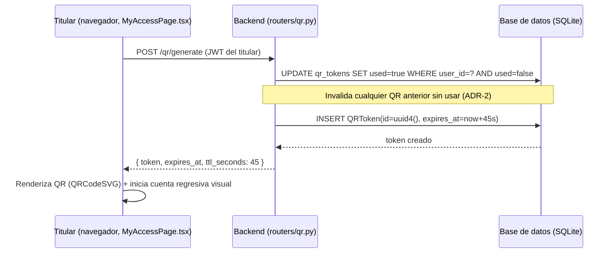
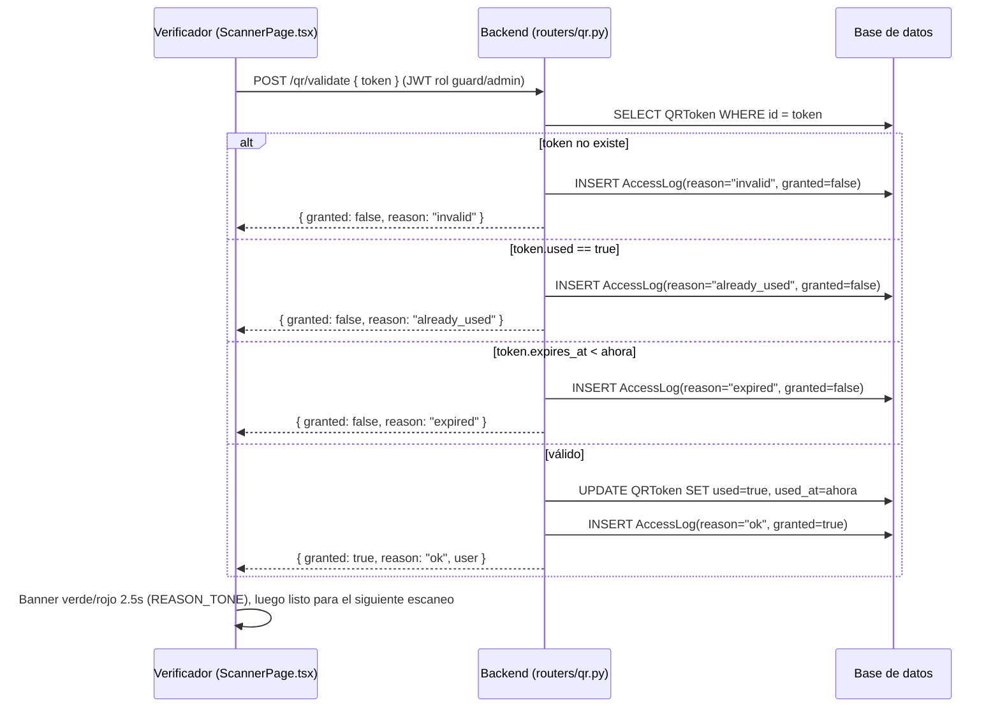
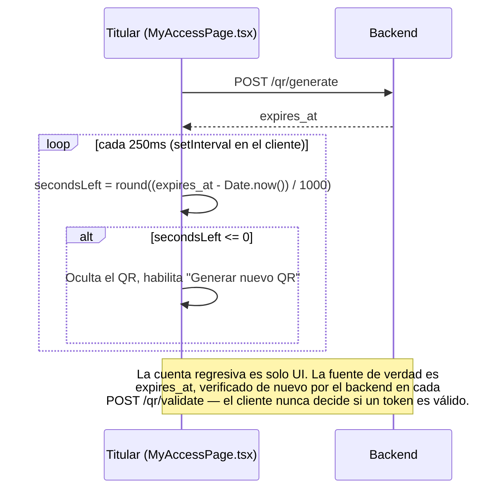
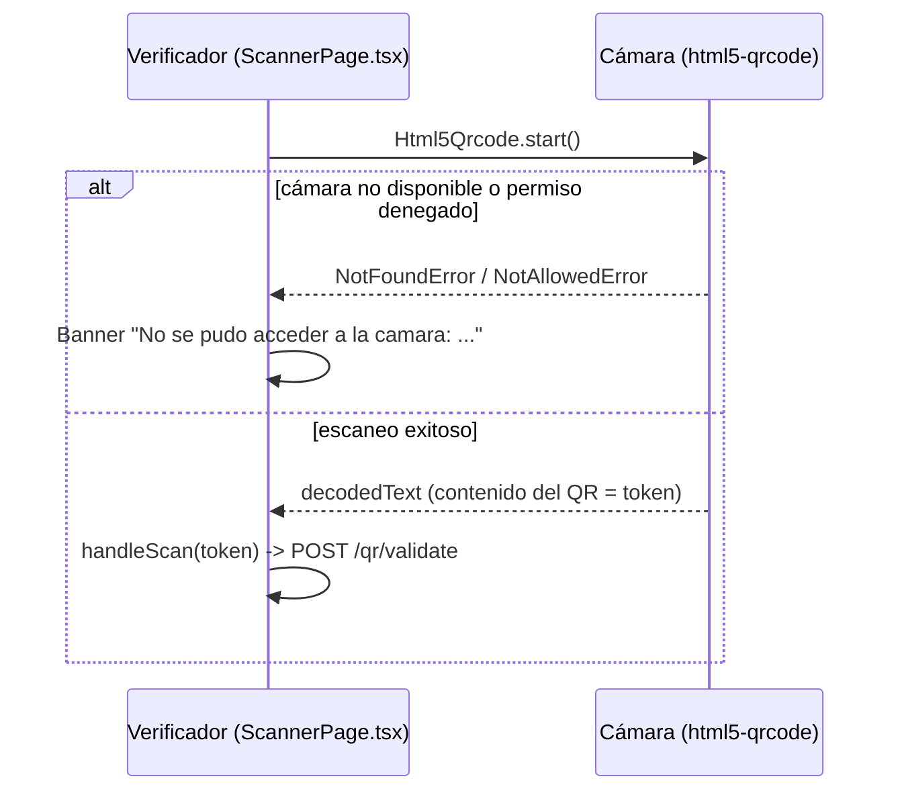

# Arquitectura del prototipo de verificación por QR dinámico

Los diagramas siguientes reflejan el flujo **real** implementado (no un diseño aspiracional):
cada paso referencia el archivo y la función que lo ejecuta.

## 1. Emisión del QR

## 2. Verificación

## 3. Expiración y regeneración

## 4. Manejo de errores del escáner

## 5. Decisiones de diseño (ADR)

**ADR-1 — Token opaco verificado contra estado del servidor, en vez de un token autocontenido y
firmado.**
Se optó por un identificador aleatorio (UUID v4) que el backend busca en su base de datos, en
lugar de un token tipo JWT que incluyera su propia firma y expiración verificables sin consultar
la base de datos. *Razón*: un token opaco es trivialmente revocable en cualquier momento (borrar o
marcar la fila) y no requiere gestión de claves de firma adicional para este componente; el costo
es que no hay verificación offline ni autoverificación criptográfica (declarado explícitamente en
`security-guarantees.md §2.1`). Alternativa considerada y descartada para este prototipo: firmar
el payload con HMAC para que el verificador pudiera comprobar la expiración sin ir a la base de
datos primero — se descarta porque no cambia la propiedad de fondo (revocación temprana seguiría
requiriendo consulta al servidor) y añade superficie de implementación sin mover la clasificación
de garantía de la Sección 5 de `security-guarantees.md`.

**ADR-2 — Generar un QR nuevo invalida cualquier QR anterior sin usar del mismo usuario.**
Reduce la ventana real de exposición por debajo del TTL nominal (ver `ttl-justification.md §6`) y
evita que existan múltiples códigos "vivos" simultáneos para una misma persona, lo que simplifica
el modelo de amenazas (un solo código válido a la vez, no N).

**ADR-3 — TTL de 45 segundos.**
Justificado en `docs/ttl-justification.md` a partir de dos cotas (usabilidad ajustada por
arquetipos de usuario, y exposición a *replay* anclada en RFC 6238), no elegido por conveniencia.

**ADR-4 — SQLite como almacenamiento.**
Adecuado para un prototipo de alcance acotado (decenas de usuarios concurrentes de prueba); se
declara explícitamente como **no apto para un despliegue de producción a escala** — un
reemplazo por PostgreSQL no cambiaría ninguna de las propiedades de seguridad discutidas, es
puramente una decisión de escala de infraestructura fuera del alcance de este trabajo.

**ADR-5 — Sin verificación biométrica.**
Ver justificación completa en `security-guarantees.md §4` (minimización de datos, alcance de
prototipo, consistencia con el modelo de amenazas).

**ADR-6 — Modelo de roles `admin` / `guard` / `resident`.**
Mapea los tres actores físicos reales de un control de acceso (quien administra el sistema, quien
verifica en portería, quien solicita el ingreso), en vez de un modelo de permisos más granular
tipo RBAC completo — proporcionado por `require_roles` (`backend/app/deps.py`), suficiente para el
alcance del prototipo y consistente con los hallazgos de la encuesta, que identifican tres tipos de
interacción con un sistema de identificación digital (usuario final, verificador institucional,
administrador del sistema).

> **Actualización (caso de aplicación: eventos masivos).** El rol `resident` se eliminó: el usuario
> final ya no tiene cuenta, sino una **entrada nominativa** (`Ticket`) que obtiene su sesión con
> RUT + código de entrada (ADR-7). Los tres actores se mantienen: asistente, guardia de fila,
> administrador del evento.

**ADR-7 — El asistente obtiene su QR con RUT + código de entrada, no con un solo dato personal.**
Pedir solo el RUT (o email) sería *identificación* sin *autenticación*: el RUT es conocido por
terceros, así que cualquiera podría generar el QR de otra persona y entrar primero (A7 en
`threat-model.md`). El código de entrada (8 caracteres, ~40 bits, entregado al comprar y guardado
solo como hash SHA-256) agrega un factor de posesión sin requerir contraseña ni servicios externos
(correo/SMS). `POST /tickets/claim` responde un 401 idéntico ante cualquier fallo (anti enumeración)
y tiene rate limit por IP. El primer claim liga la entrada a una sesión (`Ticket.claim_session`,
viaja como `sid` en el JWT): un segundo dispositivo recibe 409 hasta que soporte la libere (A8).
Alternativa descartada por ahora: RUT + OTP por correo — más fricción y dependencia de un
proveedor de envío; queda como extensión para recuperar acceso desde otro dispositivo.

**ADR-8 — Admisión única por entrada y consumo atómico del QR.**
El uso único por *token* no basta en un evento: tras ingresar, la persona podría generar otro QR y
pasárselo a alguien (pass-back, A9). `Ticket.admitted_at` se fija al primer ingreso y bloquea
nuevas emisiones. Además, con varias filas escaneando en paralelo, leer `used` y luego escribirlo
dejaba una carrera; ahora el consumo es un `UPDATE ... WHERE used = 0 AND expires_at >= now`
decidido por `rowcount` (`routers/qr.py::validate_qr`), cubierto por un test concurrente.

**ADR-9 — Filas (`Gate`) y métricas por fila como evidencia empírica.**
La hipótesis de la tesis ("filas con menos gente") no se puede afirmar sin medirla. Cada escaneo
registra su fila (`gate_id`) y su latencia de validación en el servidor (`latency_ms`);
`GET /metrics` agrega por fila escaneos, concedidos, rechazos por motivo, escaneos/min y latencia
p50/p95. Con la tasa de llegada, el largo esperado de fila se estima por teoría de colas (ley de
Little). La propuesta operativa es una **fila rápida** para quienes ya activaron su QR y una fila
normal para el resto. Pendiente: prueba de carga con N filas y el modelo de colas formal
(`docs/queue-model.md`), y reevaluar ADR-1 (token firmado verificable sin conexión) con esos datos.

## 6. Diseño de interfaz orientado a los arquetipos de usuario (Anexo A.2)

Ver `README.md §Mapeo a la tesis` para la tabla completa de trazabilidad entre cada arquetipo, su
recomendación de diseño y el elemento de interfaz correspondiente en `frontend/src/pages/`.
